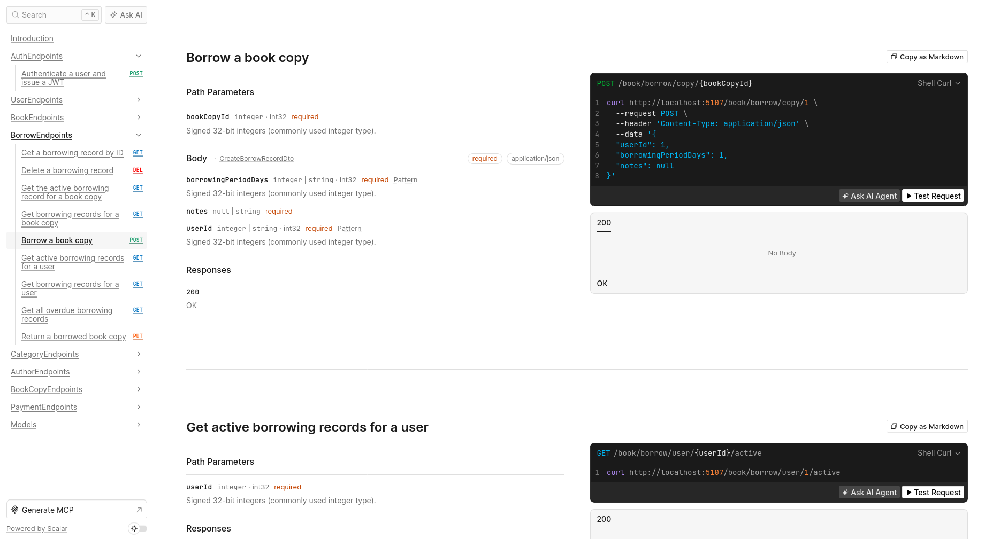
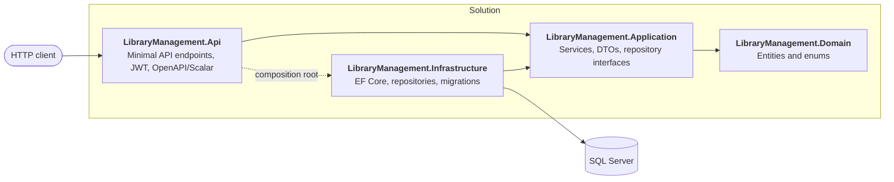
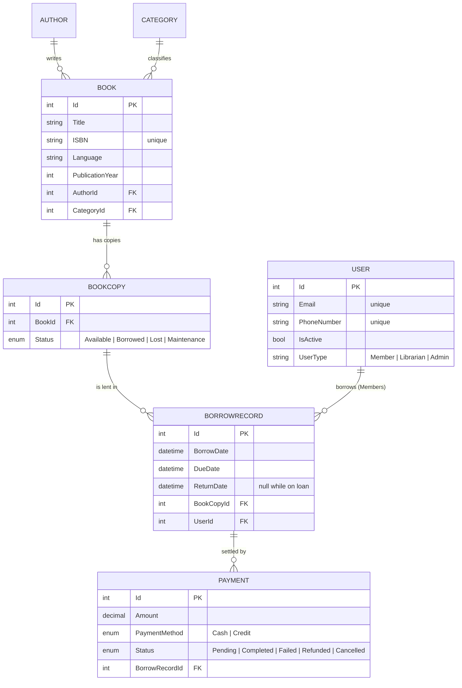
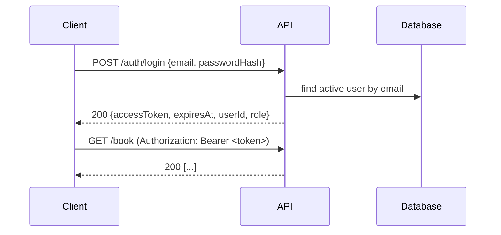

<div align="center">

# 📚 Library Management System API

**A clean-architecture REST API for running a library: catalogue, copies, members, borrowing, returns and payments.**


</div>

---

## ✨ Overview

Library Management System is a back-end service that automates the day-to-day work of a library: keeping the catalogue
up to date, tracking every physical copy of every book, managing members and staff, issuing and returning books, and
recording the payments that come out of borrowing.

It is built with **ASP.NET Core Minimal APIs**, **Entity Framework Core (code-first)** and **SQL Server**, and is split
into four layers following **Clean Architecture** so that business rules never depend on frameworks or databases.

| | |
|---|---|
| 🔌 **65 endpoints** | across 8 resource groups: auth, books, copies, borrowing, authors, categories, payments, users |
| 🔐 **JWT authentication** | every endpoint except `/auth/login` requires a bearer token |
| 🔎 **Fuzzy book search** | typo-tolerant ranking by title and description |
| 📖 **Copy-level tracking** | a *book* is a title; each physical *copy* has its own status and borrow history |
| 🧪 **Interactive API docs** | OpenAPI document + [Scalar](https://scalar.com) UI served in development |
| 🐳 **One-command database** | SQL Server 2022 via `docker compose` |

## 🖥️ API Reference UI

The API publishes an OpenAPI document and an interactive reference (powered by **Scalar**) in the `Development`
environment. You can browse every endpoint, see the request/response schemas, generate client snippets, paste in your
JWT and fire real requests with **Test Request**.



| URL (default dev setup) | What it serves |
|---|---|
| `http://localhost:5107/scalar/v1` | Interactive API reference |
| `http://localhost:5107/openapi/v1.json` | Raw OpenAPI document (import into Postman, Insomnia, code generators…) |

## 🏗️ Architecture



The dependency rule points inwards: **Domain** knows nothing about any other layer, **Application** defines the
contracts it needs (`IUnitOfWork`, repository interfaces) and **Infrastructure** implements them.

```
src/
├── LibraryManagement.Api              # Endpoints/, Program.cs, appsettings*.json
├── LibraryManagement.Application      # Services/, DTOs/, Common/Interfaces/{Persistence,Services}
├── LibraryManagement.Domain           # Entities/, Enums/
└── LibraryManagement.Infrastructure   # Persistence/{Repositories,Configurations,Migrations}, FuzzySearch.cs
```

**Patterns in use:** Repository + Unit of Work · DTOs (C# records) for every request/response · dependency injection
through `AddApplication()` / `AddInfrastructure()` · EF Core table-per-hierarchy for users · code-first migrations.

## 🗄️ Data Model



`User` is an abstract base mapped to a single `Users` table with a `UserType` discriminator:

| Type | Extra data |
|---|---|
| **Member** | membership start & expiry dates, borrow history |
| **Librarian** | department, hire date |
| **Admin** | – |

## 🚀 Getting Started

### Prerequisites

* [.NET 10 SDK](https://dotnet.microsoft.com/download)
* [Docker](https://www.docker.com/) (for SQL Server) — or any reachable SQL Server instance

### 1. Clone and start the database

```bash
git clone https://github.com/jsyph/LibraryManagementSystem.git
cd LibraryManagementSystem

docker compose up -d        # SQL Server 2022 on localhost:1433
```

### 2. Apply the EF Core migrations

```bash
dotnet tool restore         # installs dotnet-ef and csharpier from dotnet-tools.json
dotnet ef database update \
  --project src/LibraryManagement.Infrastructure \
  --startup-project src/LibraryManagement.Api
```

### 3. Create the first admin

Every user endpoint requires a token, and a token requires a user, so the very first account has to be inserted
directly into the database:

```bash
docker exec -it library-mssql /opt/mssql-tools18/bin/sqlcmd \
  -S localhost -U sa -P 'Library@Passw0rd2026' -C -d LibraryManagement -Q \
  "INSERT INTO Users (FirstName, LastName, Email, PasswordHash, PhoneNumber, IsActive, DateAdded, UserType)
   VALUES ('Ada', 'Admin', 'admin@library.local', 'change-me', '+10000000000', 1, SYSUTCDATETIME(), 'Admin');"
```

> ℹ️ The login endpoint compares the submitted `passwordHash` value with the stored one using a constant-time
> comparison, so whatever string is stored here is what you send when logging in. See [Known limitations](#-known-limitations).

### 4. Run the API

The repository does not ship a `launchSettings.json`, so run in the **Development** environment explicitly (this is what
loads the connection string, the dev JWT key, OpenAPI and Scalar):

```bash
# macOS / Linux
ASPNETCORE_ENVIRONMENT=Development dotnet run --project src/LibraryManagement.Api --urls http://localhost:5107
```

```powershell
# Windows PowerShell
$env:ASPNETCORE_ENVIRONMENT = "Development"
dotnet run --project src/LibraryManagement.Api --urls http://localhost:5107
```

Open **http://localhost:5107/scalar/v1**, call `POST /auth/login`, copy the `accessToken` into the **Bearer Token**
field and you are in.

### Configuration

| Setting | Where | Notes |
|---|---|---|
| `ConnectionStrings:LibraryDatabase` | `appsettings.Development.json` | Defaults match `docker-compose.yml` |
| `Jwt:Key` | `appsettings.Development.json` | Dev-only key — **override via user-secrets or an environment variable in any real deployment** |
| `Jwt:Issuer` / `Jwt:Audience` | `appsettings.json` | `LibraryManagement.Api` / `LibraryManagement.Client` |

Environment variables use the usual double-underscore form, e.g. `Jwt__Key` and `ConnectionStrings__LibraryDatabase`.

## 🔐 Authentication



* Tokens are **HMAC-SHA256 signed JWTs**, valid for **1 hour**, carrying the user's id, email and role as claims.
* Issuer, audience, signature and lifetime are all validated.
* Only **active** users can log in; an unknown user or wrong credential returns `401`.

## 🧭 Tour of the API

All requests below assume `TOKEN` holds a valid JWT and `API=http://localhost:5107`.

```bash
# 0. Log in
curl -s $API/auth/login -H 'Content-Type: application/json' \
  -d '{"email":"admin@library.local","passwordHash":"change-me"}'
# → { "accessToken": "eyJ…", "expiresAt": "…", "userId": 1, "role": "Admin" }

AUTH=(-H "Authorization: Bearer $TOKEN" -H 'Content-Type: application/json')

# 1. Build the catalogue
curl -s $API/category "${AUTH[@]}" -d '{"name":"Science Fiction","description":"Speculative fiction"}'
curl -s $API/author   "${AUTH[@]}" -d '{"firstName":"Ursula","lastName":"Le Guin","nationality":"American"}'
curl -s $API/book     "${AUTH[@]}" -d '{"title":"The Left Hand of Darkness","isbn":"9780441478125",
                                        "publicationYear":1969,"authorId":1,"categoryId":1}'

# 2. Stock three physical copies of book #1
curl -s $API/book/copies/b/1 "${AUTH[@]}" -d '{"count":3}'

# 3. Register a member with a 12-month membership
curl -s $API/user/members "${AUTH[@]}" -d '{"firstName":"Sam","lastName":"Reader","email":"sam@example.com",
      "phoneNumber":"+15550100","passwordHash":"…","membershipDurationMonths":12}'

# 4. Lend copy #1 to member #2 for 14 days
curl -s $API/book/borrow/copy/1 "${AUTH[@]}" -d '{"userId":2,"borrowingPeriodDays":14,"notes":"First loan"}'

# 5. Typo-tolerant search finds it even with a misspelling
curl -s "$API/book/search?SearchTerm=left%20hnad%20darknes" "${AUTH[@]}"

# 6. See what is late, then take the book back
curl -s $API/book/borrow/overdue "${AUTH[@]}"
curl -s -X PUT $API/book/borrow/copy/1/return "${AUTH[@]}" -d '{"notes":"Returned in good condition"}'

# 7. Record a late-fee payment against the loan, then mark it paid
curl -s $API/payment "${AUTH[@]}" -d '{"borrowRecordId":1,"amount":2.50,"paymentMethod":1,"notes":"Late fee"}'
curl -s -X PATCH $API/payment/1/status "${AUTH[@]}" -d '{"status":2}'
```

> Enums are sent as integers — `BookStatus`: 1 Available · 2 Borrowed · 3 Lost · 4 Maintenance ·
> `PaymentMethod`: 1 Cash · 2 Credit · `PaymentStatus`: 1 Pending · 2 Completed · 3 Failed · 4 Refunded · 5 Cancelled ·
> `UserRole`: 1 Member · 2 Librarian · 3 Admin.

## 🔎 Endpoint Reference

<details open>
<summary><b>Auth</b> (1)</summary>

| Method | Path | Description |
|---|---|---|
| `POST` | `/auth/login` | Authenticate a user and issue a JWT *(anonymous)* |

</details>

<details>
<summary><b>Books</b> (9)</summary>

| Method | Path | Description |
|---|---|---|
| `GET` | `/book` | Get all books |
| `GET` | `/book/{id}` | Get a book by ID |
| `GET` | `/book/isbn/{isbn}` | Get a book by ISBN |
| `GET` | `/book/search?SearchTerm=` | Fuzzy search over title and description |
| `GET` | `/book/author/{authorId}` | Books by author |
| `GET` | `/book/category/{categoryId}` | Books in a category |
| `POST` | `/book` | Create a book |
| `PUT` | `/book/{id}` | Update a book |
| `DELETE` | `/book/{id}` | Delete a book |

Each book includes `totalCopyCount` and `availableCopyCount`, so availability is visible at a glance.

</details>

<details>
<summary><b>Book copies</b> (8)</summary>

| Method | Path | Description |
|---|---|---|
| `GET` | `/book/copies/{id}` | Get a copy by ID |
| `GET` | `/book/copies/b/{bookId}` | Copies of a book |
| `GET` | `/book/copies/b/{bookId}/all` | All copies of a book |
| `GET` | `/book/copies/b/{bookId}/available` | Only the copies that can be borrowed now |
| `GET` | `/book/copies/status/{bookStatus}` | Copies by status (1–4) |
| `POST` | `/book/copies/b/{bookId}` | Add N copies of a book |
| `PATCH` | `/book/copies/{id}/status` | Change a copy's status (e.g. Lost, Maintenance) |
| `DELETE` | `/book/copies/{id}` | Delete a copy |

</details>

<details>
<summary><b>Borrowing</b> (9)</summary>

| Method | Path | Description |
|---|---|---|
| `POST` | `/book/borrow/copy/{bookCopyId}` | Borrow a copy |
| `PUT` | `/book/borrow/copy/{bookCopyId}/return` | Return a copy |
| `GET` | `/book/borrow/{id}` | Get a borrowing record |
| `GET` | `/book/borrow/overdue` | All overdue records |
| `GET` | `/book/borrow/copy/{bookCopyId}` | Full loan history of a copy |
| `GET` | `/book/borrow/copy/{bookCopyId}/active` | Current loan of a copy |
| `GET` | `/book/borrow/user/{userId}` | Full borrowing history of a user |
| `GET` | `/book/borrow/user/{userId}/active` | What a user currently has on loan |
| `DELETE` | `/book/borrow/{id}` | Delete a record (frees the copy if it was still on loan) |

</details>

<details>
<summary><b>Authors</b> (6)</summary>

| Method | Path | Description |
|---|---|---|
| `GET` | `/author` | Get all authors |
| `GET` | `/author/{id}` | Get an author |
| `GET` | `/author/search?FirstName=&LastName=&Nationality=` | Search authors |
| `POST` | `/author` | Create an author |
| `PUT` | `/author/{id}` | Update an author |
| `DELETE` | `/author/{id}` | Delete an author |

</details>

<details>
<summary><b>Categories</b> (5)</summary>

| Method | Path | Description |
|---|---|---|
| `GET` | `/category` | Get all categories |
| `GET` | `/category/{id}` | Get a category |
| `POST` | `/category` | Create a category |
| `PUT` | `/category/{id}` | Update a category |
| `DELETE` | `/category/{id}` | Delete a category |

</details>

<details>
<summary><b>Payments</b> (8)</summary>

| Method | Path | Description |
|---|---|---|
| `GET` | `/payment` | Get all payments |
| `GET` | `/payment/{id}` | Get a payment |
| `GET` | `/payment/borrow/{borrowRecordId}` | Payments for a loan |
| `GET` | `/payment/date-range?StartTime=&EndTime=` | Payments within a date range |
| `GET` | `/payment/search` | Filter by method, date, status, notes |
| `POST` | `/payment` | Create a payment (starts as *Pending*) |
| `PATCH` | `/payment/{id}/status` | Change payment status (stamps `lastStatusChange`) |
| `DELETE` | `/payment/{id}` | Delete a payment |

</details>

<details>
<summary><b>Users</b> (19)</summary>

| Method | Path | Description |
|---|---|---|
| `GET` | `/user/search` | Search by name, email, phone, date added, role, active flag |
| `GET` · `POST` | `/user/members` | List / create members |
| `GET` · `PUT` · `DELETE` | `/user/members/{id}` | Read / update / delete a member |
| `PATCH` | `/user/members/renew` | Renew a membership by N months |
| `GET` · `POST` | `/user/librarians` | List / create librarians |
| `GET` · `PUT` · `DELETE` | `/user/librarians/{id}` | Read / update / delete a librarian |
| `GET` · `POST` | `/user/admins` | List / create admins |
| `GET` · `PUT` | `/user/admins/{id}` | Read / update an admin |
| `PATCH` | `/user/{id}/password` | Change a user's password hash |
| `PATCH` | `/user/{id}/activate` · `/deactivate` | Activate / deactivate any user |

</details>

## 📐 Business Rules

**Borrowing**
* A copy can be borrowed only if its status is `Available`, it has no open loan, and the borrower exists and is **active**.
* `DueDate = BorrowDate + borrowingPeriodDays` (UTC); the copy flips to `Borrowed`.
* Returning stamps `ReturnDate`, stores the return notes and flips the copy back to `Available`.
* `isOverdue` is computed on every read: no return date **and** now is past the due date.
* Deleting a loan that has not been returned releases the copy.

**Memberships**
* Members get an expiry date from `membershipDurationMonths` at registration.
* Renewing extends from the *later* of the current expiry and today, and re-activates the member.

**Search**
* Book search tokenises the query, strips accents and punctuation, and scores each book with **Levenshtein similarity**
  (exact = 1.0, containment = 0.95). Books under a 0.55 average score are dropped and the rest are ranked best-first.
* ISBN, e-mail and phone are matched exactly and are deliberately not part of the fuzzy search.

**Integrity**
* Unique: book ISBN, category name, user e-mail, user phone number.
* Authors and categories that still have books cannot be deleted (`Restrict`). Deleting a book cascades to its copies,
  unless any of those copies has loan history (copies referenced by borrow records are protected by `Restrict`).
  Deleting a loan cascades to its payments.

## 🛠️ Development

```bash
dotnet build                      # build the whole solution
dotnet csharpier .                # format (tool pinned in dotnet-tools.json)

# add a migration after changing entities
dotnet ef migrations add <Name> \
  --project src/LibraryManagement.Infrastructure \
  --startup-project src/LibraryManagement.Api
```

`src/LibraryManagement.Api/LibraryManagement.Api.http` can be used from Visual Studio / Rider for quick manual requests.

## 🧰 Tech Stack

ASP.NET Core Minimal APIs · Entity Framework Core 10 · SQL Server 2022 · JWT Bearer authentication ·
Microsoft.AspNetCore.OpenApi · Scalar.AspNetCore · CSharpier · Docker Compose
